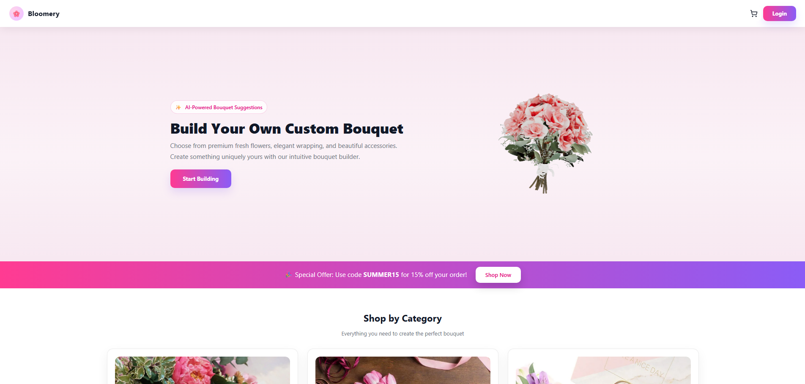
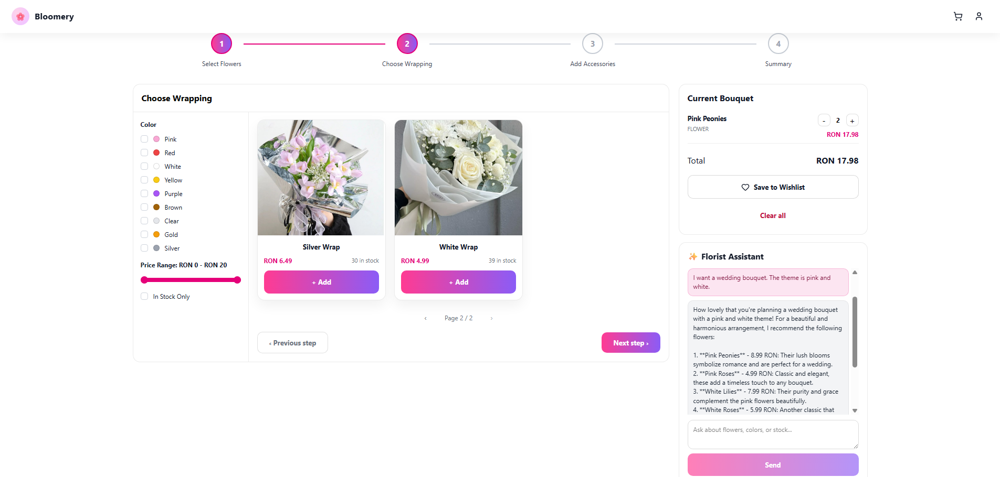
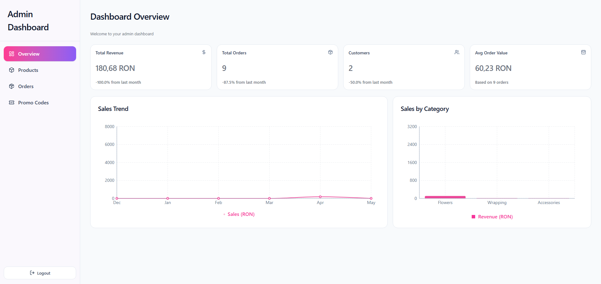

# Bloomery 🌸

O platformă web inovatoare de tip e-commerce destinată realizării, personalizării și comandării de buchete florale. Aplicația extinde modelul tradițional de florărie online, permițând utilizatorilor să își construiască buchetul dorit de la zero, prin intermediul unui configurator interactiv, și să beneficieze de asistență personalizată oferită de inteligența artificială.

## 🌐 Live Demo

Platforma este live și poate fi accesată aici:
**[👉 Vizitează Bloomery](https://bloomery.arts.ro/home)**

## 📸 Galerie / Capturi de ecran

| Pagina Principală & Model 3D | Configuratorul de Buchete |
| :---: | :---: |
|  |  |

| Asistentul Virtual (AI) | Panoul Administrativ |
| :---: | :---: |
|  |  |

## 🚀 Funcționalități Principale

* **Configurator Interactiv de Buchete**: Utilizatorii pot selecta flori, ambalaje și accesorii individuale, prețul final fiind recalculat automat în timp real în funcție de opțiunile alese.
* **Asistent Virtual AI (Florist Assistant)**: Un chatbot integrat cu OpenAI care sprijină procesul decizional, oferind recomandări personalizate în funcție de ocazie, buget și preferințe cromatice.
* **Model 3D**: Pagina principală include o randare 3D a unui buchet floral, realizată pentru a evidenția flexibilitatea și caracterul personalizabil al produselor.
* **Flux E-commerce Complet**: Sistem flexibil de coș de cumpărături disponibil atât pentru clienții autentificați, cât și pentru vizitatori (guest), cu opțiuni de livrare programată și aplicare de coduri promoționale.
* **Plăți Securizate**: Integrare nativă cu Stripe pentru procesarea plăților online, statusul comenzilor fiind actualizat automat și asincron prin intermediul webhook-urilor.
* **Panou de Administrare (Admin Dashboard)**: Interfață protejată dedicată administratorului pentru gestionarea completă a produselor (CRUD), a stocurilor, actualizarea statusurilor comenzilor și vizualizarea statisticilor de vânzări.
* **Autentificare și Securitate**: Sistem securizat de login cu JSON Web Token (JWT) bazat pe cookie-uri HTTP-only, suport pentru autentificare Google (SSO) și criptarea parolelor cu bcrypt.

## 💻 Tehnologii Utilizate

Platforma este construită folosind o arhitectură decuplată (Single Page Application, RESTful API, Bază de date).

**Frontend**
* **React 19** & **Vite**
* **Tailwind CSS 4.2**
* **Redux 5** & **Thunk**
* **Three.js** & **@react-three/fiber**
* **React Router DOM 7**

**Backend**
* **Node.js** & **Express**
* **Multer**

**Baze de Date & Servicii Externe**
* **PostgreSQL** & **Prisma ORM** (Neon)
* **Stripe API**
* **OpenAI API**
* **Cloudinary**
* **Resend API**
* **Vercel** & **Render**

## 🗄️ Arhitectura Bazei de Date

Modelul relațional a fost proiectat pentru a separa clar datele de catalog, cele de personalizare și cele tranzacționale. Entitățile principale includ:
* **User**: Gestionează utilizatorii autentificați.
* **Product**: Stochează produsele brute (flori, ambalaje, accesorii).
* **Bouquet** & **ItemBouquet**: Modelează relația many-to-many pentru configuratorul de buchete.
* **Order**: Păstrează istoricul tranzacțional sub formă de instantanee (snapshots), asigurând integritatea prețurilor în timp, independent de modificările ulterioare ale catalogului.
